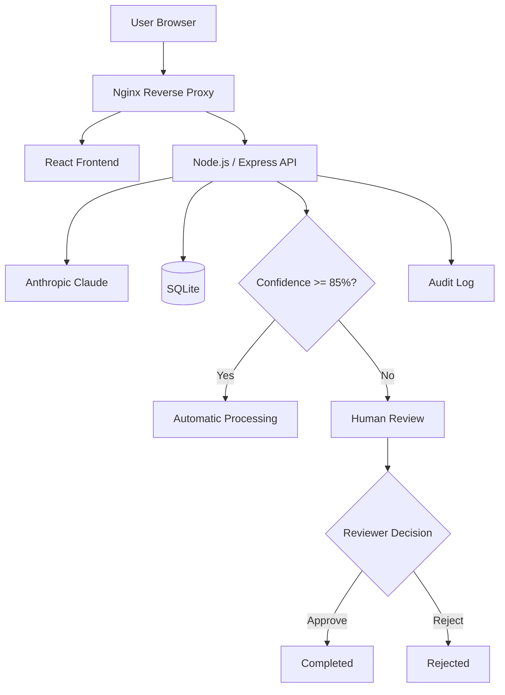

# FlowPilot

FlowPilot is an AI-assisted business process automation platform that analyzes incoming business requests, classifies them, assigns a priority, recommends an action, and automatically decides whether the request can be completed or should be routed to a human reviewer.

The project combines a React frontend, Node.js/Express backend, Claude AI integration, SQLite persistence, Docker, and Nginx reverse proxying.

## Overview

FlowPilot simulates a lightweight enterprise automation workflow.

A user submits a business request such as:

```text
A customer was charged twice for invoice INV-2026-991 and urgently requests a refund.
```

The request is analyzed by Claude and receives:

- a category
- a priority
- an AI confidence score
- a recommended action

The backend then applies an automation rule:

```text
Confidence >= 85%  -> Automatic Processing
Confidence < 85%   -> Human Review
```

Low-confidence requests are added to a Validation Queue where a reviewer can approve or reject them.

Every important action is recorded in an audit log.

## Features

### AI Request Analysis

Requests are analyzed using the Anthropic Claude API.

The AI returns structured information such as:

```json
{
  "category": "Refund",
  "priority": "High",
  "confidence": 95,
  "recommendedAction": "Verify the duplicate charge and process the refund"
}
```

The interface also shows which AI provider processed the request.

### Confidence-Based Automation

FlowPilot automatically routes requests based on AI confidence.

Requests with confidence greater than or equal to 85% are automatically completed.

Requests below the threshold are routed to human validation.

### Human-in-the-Loop Validation

Low-confidence requests appear in the Validation Queue.

A reviewer can:

- inspect the original request
- review the AI recommendation
- see the confidence score
- approve the request
- reject the request

### Request Details

Requests displayed on the dashboard can be opened to inspect:

- description
- category
- priority
- confidence
- recommended action
- status
- review decision
- creation timestamp

### Search and Filtering

The dashboard supports searching and filtering requests by:

- request ID
- description
- category
- priority
- status

### AI Analysis Result

After submitting a request, FlowPilot displays the AI analysis directly in the interface.

The result contains:

- AI provider
- model
- category
- priority
- confidence
- routing decision
- recommended action

When Claude is used successfully, the interface displays:

```text
Analyzed by Claude · claude-sonnet-5-5
```

If the AI API is unavailable, the application can use a local fallback analysis instead.

### Audit Log

FlowPilot records important workflow events such as:

- request creation
- AI analysis
- automatic completion
- routing to human review
- reviewer approval
- reviewer rejection

### Dashboard Analytics

The dashboard displays:

- total requests
- automatically processed requests
- requests waiting for human review
- completed requests
- automation rate
- estimated time saved

## Architecture



## Tech Stack

### Frontend

- React
- Vite
- CSS

### Backend

- Node.js
- Express
- Anthropic SDK

### Database

- SQLite
- better-sqlite3

### Infrastructure

- Docker
- Docker Compose
- Nginx reverse proxy

### AI

- Anthropic Claude
- Claude Sonnet 5.5

## Project Structure

```text
flowpilot-ai-automation/
│
├── client/
│   ├── src/
│   │   ├── App.jsx
│   │   └── App.css
│   │
│   ├── Dockerfile
│   ├── nginx.conf
│   └── package.json
│
├── server/
│   ├── db/
│   │   └── database.js
│   │
│   ├── services/
│   │   └── aiService.js
│   │
│   ├── data/
│   ├── server.js
│   ├── test-ai.js
│   ├── Dockerfile
│   ├── .env.example
│   └── package.json
│
├── docker-compose.yml
├── .gitignore
└── README.md
```

## Running with Docker

Docker is the recommended way to run FlowPilot.

### 1. Clone the repository

```bash
git clone https://github.com/YOUR_USERNAME/flowpilot-ai-automation.git
cd flowpilot-ai-automation
```

### 2. Configure the environment

Create the backend environment file:

```bash
cp server/.env.example server/.env
```

Then edit:

```text
server/.env
```

and provide your Anthropic API key:

```env
ANTHROPIC_API_KEY=your_api_key_here
ANTHROPIC_MODEL=claude-sonnet-5-5
```

Do not commit the `.env` file.

### 3. Build the containers

```bash
docker compose build
```

### 4. Start FlowPilot

```bash
docker compose up
```

Open:

```text
http://localhost
```

Nginx exposes the application on port 80 and forwards API requests to the backend container.

## Health Check

The backend exposes a health endpoint:

```bash
curl http://localhost/health
```

Expected response:

```json
{
  "status": "ok",
  "service": "flowpilot-api"
}
```

## Running Locally

The application can also be run without Docker.

### Backend

```bash
cd server
npm install
npm run dev
```

The API runs on:

```text
http://localhost:5000
```

### Frontend

Open another terminal:

```bash
cd client
npm install
npm run dev
```

The React development server runs on:

```text
http://localhost:5173
```

Vite proxies `/api` requests to the local backend.

## API Endpoints

| Method | Endpoint | Description |
|---|---|---|
| GET | `/health` | Backend health check |
| GET | `/api/requests` | Get all requests |
| POST | `/api/requests` | Analyze and create a request |
| GET | `/api/requests/review` | Get requests waiting for human review |
| PATCH | `/api/requests/:id/approve` | Approve a request |
| PATCH | `/api/requests/:id/reject` | Reject a request |
| GET | `/api/audit-logs` | Get audit history |
| GET | `/api/stats` | Get dashboard statistics |

## AI Fallback

If the Claude API is unavailable or an API key is not configured, FlowPilot can fall back to a local rule-based analysis.

This keeps the workflow functional while clearly identifying that the request was not processed by Claude.

## AI Evaluation

The backend includes an integration evaluation script:

```text
server/test-ai.js
```

It can send predefined business requests through the API to evaluate:

- classification
- priority
- confidence
- routing
- recommended actions

Because this test can call the real Claude API, running it may consume Anthropic API credits.

## Persistence

FlowPilot uses SQLite for persistence.

The database stores:

- requests
- AI classifications
- priorities
- confidence scores
- recommended actions
- workflow status
- review decisions
- audit events

The SQLite database files are intentionally excluded from Git.

## Security

Sensitive configuration is stored using environment variables.

The following files are not committed:

```text
.env
*.db
*.db-shm
*.db-wal
```

An `.env.example` file is included to document the required configuration without exposing API keys.

## Future Improvements

Possible future improvements include:

- configurable automation rules
- authentication and role-based access control
- configurable confidence thresholds
- batch request processing
- analytics and reporting
- CI/CD pipeline
- webhook integrations
- automated AI evaluation suite
- cloud deployment

## Purpose

FlowPilot was built as a full-stack learning project focused on practical AI-assisted automation and human-in-the-loop workflows.

It demonstrates the integration of frontend development, backend APIs, AI services, persistence, containerization, and reverse proxy infrastructure in a single application.